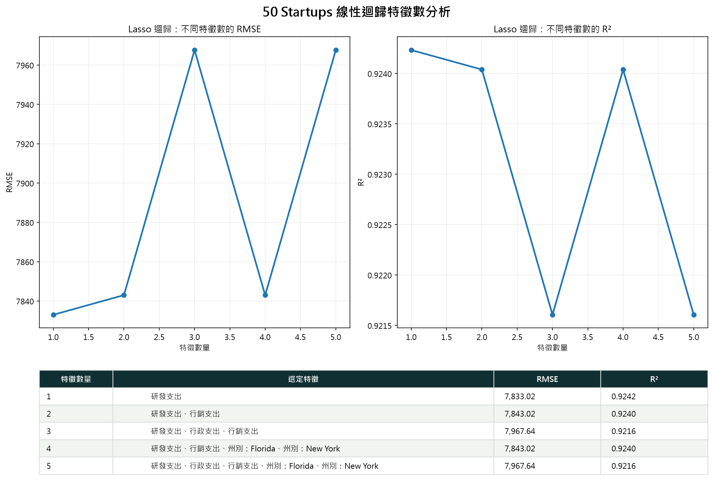

# 50 Startups：五種線性迴歸與互動式特徵選擇

本專案使用 `50_Startups.csv`，依照 **CRISP-DM（Cross-Industry Standard Process for Data Mining）** 流程，建立五種迴歸模型來預測新創公司獲利，並提供繁體中文互動式儀表板，讓使用者同時選擇：

- 迴歸演算法：Linear、Ridge、Lasso、Elastic Net、Huber
- 特徵數量：`K=1` 至 `K=5`

切換演算法或特徵數量後，評估指標、入選特徵、迴歸方程式、係數、預測結果、殘差分析與圖表都會同步更新；RMSE 與 R² 圖表也會動態高亮目前選取的 K 值。

## 線上 Demo

**GitHub Pages：<https://huangyuhsiang8810.github.io/AIoT_1014_DIC_50-Startups/>**

每次推送 `startup-profit-dashboard/dist/` 到 `main` 分支後，GitHub Actions 會自動重新部署 Demo 網頁。若首次部署尚未開啟 Pages，請到 repository 的 **Settings → Pages → Build and deployment → Source** 選擇 **GitHub Actions**。

## 專案功能

- 比較五種線性迴歸演算法的 MAE、RMSE 與 R²
- 對每個演算法分別執行 `K=1～5` 的最佳特徵子集合搜尋
- 使用訓練集 5-fold Cross Validation 選擇每個 K 的最佳特徵組合
- 顯示測試集 RMSE、R²、Adjusted R²、MAE 與 F-statistic
- 演算法與特徵數雙向連動，所有分析區塊同步刷新
- 圖表以色帶、垂直線、放大點與數值標籤高亮目前 K 值
- 輸出可重現的 JSON 資料與 PNG 分析圖
- 依照 CRISP-DM 六階段整理分析流程

## 五模型比較結果

資料使用固定切分：80% 訓練集、20% 測試集、`random_state=42`。以下為使用完整特徵時的測試集結果：

| 排名 | 模型 | MAE | RMSE | R² |
|---:|---|---:|---:|---:|
| 1 | Lasso 迴歸 | 6,419.67 | 7,967.65 | 0.9216 |
| 2 | Huber 穩健迴歸 | 6,873.35 | 8,530.55 | 0.9101 |
| 3 | 一般線性迴歸 | 6,961.48 | 9,055.96 | 0.8987 |
| 4 | Elastic Net 迴歸 | 7,049.26 | 9,077.85 | 0.8982 |
| 5 | Ridge 迴歸 | 7,070.00 | 9,082.68 | 0.8981 |

在目前固定測試集上，Lasso 的完整模型 RMSE 最低。儀表板仍可針對每個模型切換 K 值，觀察模型複雜度與預測誤差的變化。

## 特徵數分析

每個模型都會建立五組候選方案：

| K 值 | 說明 |
|---:|---|
| `K=1` | 使用 1 個最佳特徵 |
| `K=2` | 使用 2 個最佳特徵 |
| `K=3` | 使用 3 個最佳特徵 |
| `K=4` | 使用 4 個最佳特徵 |
| `K=5` | 使用完整特徵集合 |

每個 K 的特徵組合先以訓練集 5-fold Cross Validation 比較，再使用最佳組合訓練並計算測試集指標。網頁選取 K 後，對應點會在 RMSE 與 R² 圖表中動態高亮。



## CRISP-DM 流程

1. **Business Understanding**：定義獲利預測、模型比較與特徵精簡目標。
2. **Data Understanding**：確認 50 筆資料、三個支出欄位、州別與獲利欄位。
3. **Data Preparation**：切分資料、One-Hot Encoding、標準化並建立特徵子集合。
4. **Modeling**：訓練五種迴歸模型，並對每個模型搜尋 `K=1～5` 的最佳組合。
5. **Evaluation**：比較 MAE、RMSE、R²、Adjusted R²、F-statistic 與殘差。
6. **Deployment**：輸出 JSON、PNG，並以靜態互動式網站呈現結果。

完整內容請參閱 [`docs/CRISP-DM.md`](docs/CRISP-DM.md)。

## 專案結構

```text
.
├── 50_Startups.csv
├── main.py
├── compare_models.py
├── model_comparison_results.json
├── linear_regression_feature_progression.png
├── requirements.txt
├── README.md
├── .github/
│   └── workflows/
│       └── deploy-pages.yml
├── docs/
│   └── CRISP-DM.md
└── startup-profit-dashboard/
    └── dist/
        ├── index.html
        ├── styles.css
        ├── app.js
        ├── model_results.json
        ├── 50_Startups.csv
        └── linear_regression_feature_progression.png
```

## 安裝與執行

### 1. 建立虛擬環境

```powershell
python -m venv .venv
.\.venv\Scripts\Activate.ps1
```

### 2. 安裝套件

```powershell
python -m pip install -r requirements.txt
```

### 3. 執行基礎線性迴歸

```powershell
python main.py
```

### 4. 重新產生五模型與特徵分析

```powershell
$env:PYTHONIOENCODING='utf-8'
python compare_models.py
```

執行後會更新：

- `model_comparison_results.json`
- `linear_regression_feature_progression.png`
- `startup-profit-dashboard/dist/model_results.json`
- `startup-profit-dashboard/dist/linear_regression_feature_progression.png`

### 5. 啟動互動式網站

```powershell
python -m http.server 8765 --directory startup-profit-dashboard\dist
```

瀏覽器開啟 <http://127.0.0.1:8765/>。

## 使用方式

1. 在「選擇迴歸演算法」切換五種模型。
2. 在「選擇特徵數量」切換 `K=1～5`。
3. 查看指標卡、有效預測特徵與迴歸方程式的同步變化。
4. 查看 RMSE、R² 圖表中高亮的 K 值與數值。
5. 查看跨模型排名、係數、預測值與殘差分析。

## 技術工具

- Python、Pandas、NumPy
- scikit-learn、SciPy、Matplotlib
- HTML、CSS、Vanilla JavaScript、SVG

## 分析限制

- 資料只有 50 筆，測試集僅 10 筆，評估結果可能對資料切分敏感。
- 儀表板的「最佳 K」是目前固定測試集 RMSE 最低者，適合教學與探索，不應直接視為無偏的泛化效能估計。
- 若用於正式決策，建議增加資料量，並使用 Nested Cross Validation 或獨立驗證集選擇模型與 K 值。
